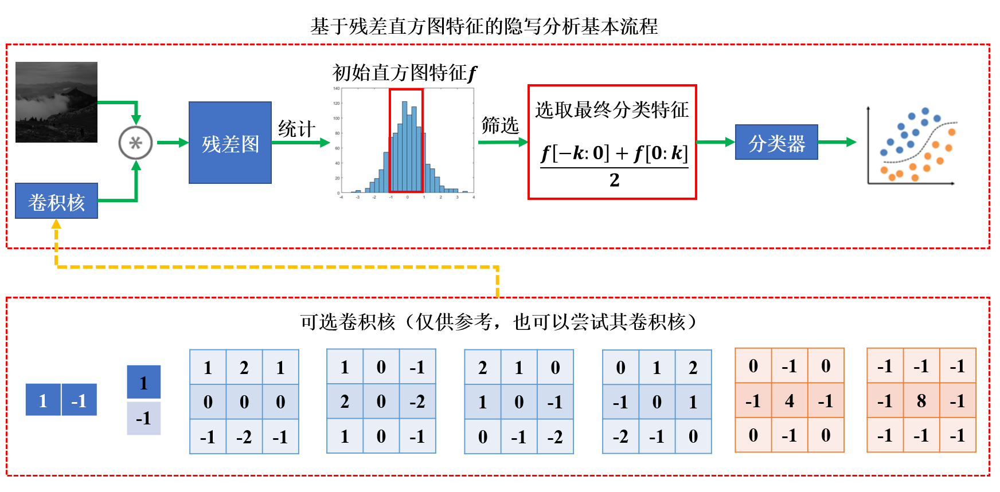

# 2026 机器学习大作业一

## 一、基本任务

要求每位同学使用常用的机器学习分类方法，实现对 **Cover/Stego** 图像数据集的二分类，基本实验流程可参考文档末尾所附流程图。

## 二、基本要求

1. 所用分类模型不做限制。可以选择包括逻辑回归（LR）、线性判别分析（FLD）、支持向量机（SVM）等方法在内的多种分类模型。

2. 至少使用两种分类模型完成 **Cover/Stego** 图像二分类任务。建议大家合理规划，在规定的时间内使用尽可能多的分类模型完成二分类任务。

3. 编程语言不限。**Python** 等常用编程语言均可。无论具体选择何种编程语言，无论最后使用几种分类模型，建议大家使用一种编程语言完成所有任务。

4. 建议每位同学最好自己动手编程实现相关分类模型。当然，如果觉得编程难度较大，也可以直接调用机器学习库（如 Python 中的 **Sk-learn**）中现成的分类模型，或者参考网络和书籍中的现成代码。

5. 每人独立完成。同学之间不得互相抄袭，如果发现同学之间存在相互抄袭的情况，抄袭者与被抄袭者的成绩都会被影响，请大家认真对待。

6. 大作业完成后，要求每位同学最晚于 **12 月 29 日**之前，提交一份 **ZIP** 压缩包（以“学号-姓名-大作业1”的格式命名），压缩包里面需要包含一份大作业报告（**PDF** 格式，不超过 10 页）和一份实验源代码（要求可以跑通）。作业完成后可发送至邮箱 **bjtu2026ml@163.com**。

7. 大作业报告的内容和格式不做细致要求，但至少要包括以下信息：

   - ① 如何划分训练集/测试集；
   - ② 选取何种分类特征；
   - ③ 提取特征的基本流程；
   - ④ 选取何种分类模型；
   - ⑤ 实验结果的展示与对比，建议使用多种评价指标（如 ACC、AUC 等），并以可视化的形式对实验结果进行展示与对比；
   - ⑥ 实验心得体会；
   - ⑦ 大作业报告的首页需包含个人的姓名、学号等基本信息，最后一页需要附上源代码的基本使用方法。

## 三、备注

1. 实验数据集：**Cover/Stego** 图像数据集。该数据集共包含 **20000** 张图像，其中 **10000** 张为 Cover 图像，另 **10000** 张为 Stego 图像。

2. 各个分类模型的分类效果好坏并不重要，但至少要高于 **50%**，否则应该是代码编写错误。

