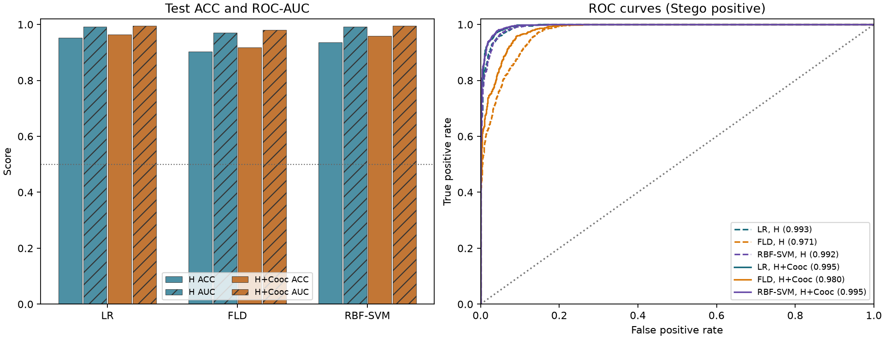
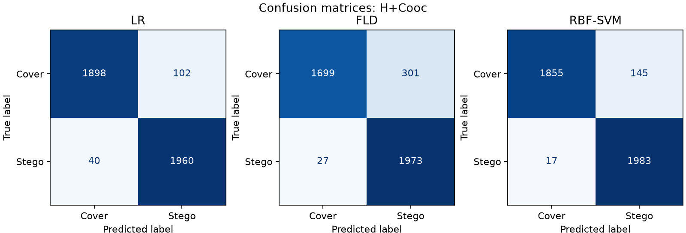

# 2026 机器学习大作业一：Cover/Stego 图像二分类

| 项目 | 内容 |
|---|---|
| 姓名 | **请填写** |
| 学号 | **请填写** |
| 专业/班级 | **请填写** |
| 实验环境 | Python 3.14，NumPy 2.5.4，SciPy 1.18.1，scikit-learn 1.9.1，Pillow 13.0.0 |

## 1. 实验目的

本实验使用 Cover/Stego 图像数据集完成二分类任务：输入一张灰度图像，判断它属于原始 Cover 图像还是经过隐写处理的 Stego 图像。实验按照题目给出的“残差图—统计直方图—特征筛选—分类器”思路实现，并比较逻辑回归（LR）、Fisher 线性判别（FLD）和 RBF 核支持向量机（RBF-SVM）三种分类器。

## 2. 数据集与训练集/测试集划分

数据集目录为 `datasets/`，包含：

- `Cover/`：10,000 张图像；
- `Stego/`：10,000 张图像；
- 两个目录中的文件名一一对应，例如 `Cover/123.pgm` 与 `Stego/123.pgm` 属于同一图像内容的两个版本；
- 图像为 512×512 的 8 位灰度 PGM 图像。

为避免同一内容的 Cover/Stego 版本分别进入训练集和测试集，本实验以“同名图像对”为基本划分单位。使用固定随机种子 2026，将 10,000 对图像按 80%∶20% 划分：

| 数据部分 | 图像对数量 | 实际单图像数量 |
|---|---:|---:|
| 训练集 | 8,000 对 | 16,000 |
| 测试集 | 2,000 对 | 4,000 |

每个集合中 Cover 和 Stego 数量相同，因此测试集共有 2,000 个 Cover 样本和 2,000 个 Stego 样本。标准化参数只使用训练集拟合，再应用于测试集。

## 3. 特征选取与提取流程

### 3.1 残差特征

对输入图像 \(I\) 使用高通卷积核 \(K\) 得到残差图：

$$
R = I * K.
$$

代码使用了题目流程图中给出的 8 个残差核，包括：

1. 水平一阶差分 \([1,-1]\)；
2. 垂直一阶差分 \([1,-1]^T\)；
3. 水平/垂直方向三阶差分；
4. 两组对角方向差分；
5. Laplacian 核；
6. 3×3 高通核。

卷积边界处不参与统计，只保留卷积核完全覆盖图像的有效区域。

### 3.2 残差直方图特征 H

对每个残差图统计 \(|R|\) 的直方图，统计范围为 0 至 10；大于 10 的值不单独展开。对于非零残差，将正负号相同位置合并并除以 2，使特征与题目给出的对称直方图形式一致。每个卷积核得到 11 个特征，8 个卷积核共得到：

$$
8 \times 11 = 88
$$

维特征，记为 **H**。

### 3.3 残差共现特征 H+Cooc

在 H 的基础上，针对水平和垂直一阶差分残差，分别统计水平方向和垂直方向相邻残差的二阶共现频数。残差先截断到 \([-3,3]\)，每个残差共有 7 个状态；考虑正负对称后，每个方向保留 25 个特征，共得到：

$$
4 \times 25 = 100
$$

个共现特征。因此 H+Cooc 总特征数为：

$$
88 + 100 = 188.
$$

完整处理流程为：

```text
读取 512×512 灰度图
        ↓
使用 8 个高通核提取残差图
        ↓
统计残差直方图 H
        ↓
统计一阶残差的水平/垂直共现特征 Cooc
        ↓
拼接为 88 维或 188 维特征
        ↓
仅用训练集拟合 StandardScaler
        ↓
训练分类器并在测试集上评价
```

## 4. 分类模型

### 4.1 逻辑回归（LR）

使用带 L2 正则的逻辑回归，最大迭代次数设置为 2000，输出决策分数并计算 ACC、AUC 等指标。

### 4.2 Fisher 线性判别（FLD）

根据两类训练样本的均值和类内协方差矩阵计算 Fisher 投影方向：

$$
w = S_w^{-1}(\mu_1-\mu_0).
$$

由于特征维度较高，在类内协方差矩阵对角线上加入小的 ridge 项以提高数值稳定性；以两类均值在投影空间的中点作为分类阈值。

### 4.3 RBF 核支持向量机

使用 RBF 核 SVM，参数为 \(C=4\)，核宽度使用 `gamma="scale"`。分类器的决策函数用于绘制 ROC 曲线和计算 AUC。

## 5. 实验结果

测试集包含 4,000 张单图像，正类设为 Stego。结果如下，H 表示 88 维残差直方图特征，H+Cooc 表示 188 维组合特征。

| 特征 | 模型 | 维度 | ACC | AUC | Precision | Recall | F1 |
|---|---|---:|---:|---:|---:|---:|---:|
| H | LR | 88 | 0.9528 | 0.9927 | 0.9221 | 0.9890 | 0.9544 |
| H | FLD | 88 | 0.9032 | 0.9705 | 0.8448 | 0.9880 | 0.9108 |
| H | RBF-SVM | 88 | 0.9363 | 0.9924 | 0.8890 | 0.9970 | 0.9399 |
| H+Cooc | LR | 188 | **0.9645** | **0.9954** | 0.9505 | 0.9800 | **0.9650** |
| H+Cooc | FLD | 188 | 0.9180 | 0.9805 | 0.8676 | 0.9865 | 0.9233 |
| H+Cooc | RBF-SVM | 188 | 0.9595 | 0.9951 | 0.9319 | 0.9915 | 0.9608 |



### 5.1 结果分析

1. 六组实验的 ACC 均高于 90%，明显高于题目要求的 50% 基准，说明残差统计特征能够有效区分 Cover 与 Stego。
2. 最佳组合为 **H+Cooc + LR**，测试 ACC 为 0.9645，AUC 为 0.9954。
3. 在 LR 上加入共现特征后，ACC 从 0.9528 提升到 0.9645；在 RBF-SVM 上从 0.9363 提升到 0.9595，说明相邻残差之间的关系包含额外的隐写信息。
4. FLD 的 ACC 低于 LR 和 RBF-SVM，说明仅使用单一线性 Fisher 投影难以充分利用这些高维统计特征；不过加入共现特征后 FLD 的 AUC 由 0.9705 提升到 0.9805。
5. 三种模型的 Stego 召回率都较高，说明漏检 Stego 的比例较低；相对而言，误把 Cover 判为 Stego 的数量更多，表现为 Precision 低于 Recall。

以 H+Cooc 特征为例，三个模型的混淆矩阵如下，其中行是真实类别，列是预测类别，类别顺序为 Cover、Stego：

| 模型 | TN | FP | FN | TP |
|---|---:|---:|---:|---:|
| LR | 1898 | 102 | 40 | 1960 |
| FLD | 1699 | 301 | 27 | 1973 |
| RBF-SVM | 1855 | 145 | 17 | 1983 |



## 6. 实验心得

本实验的主要体会如下：

1. **数据划分必须以图像对为单位。** 如果将 Cover 和 Stego 单独随机划分，可能使同一内容的两个版本落入不同集合，从而造成数据泄漏，使测试结果不具有代表性。
2. **残差特征比原始像素更适合本任务。** 隐写操作通常对像素造成幅度很小但具有统计规律的改变，高通滤波可以削弱图像内容本身的影响，突出这种细微变化。
3. **特征组合可以提升模型效果。** 残差直方图描述单点统计分布，共现特征进一步描述相邻残差关系；二者结合后，LR 和 RBF-SVM 的效果均有提升。
4. **评价指标需要综合使用。** ACC 反映整体分类正确率，AUC 反映不同阈值下的排序能力，Precision、Recall 和 F1 能进一步观察误报与漏报情况。只报告单一指标可能无法完整反映模型性能。
5. **工程实现需要关注效率和可复现性。** 本代码使用多进程并行提取图像特征，并固定随机种子 2026；同时将指标和图表保存到 `results/`，便于复现实验和撰写报告。

## 7. 源代码基本使用方法

本节为报告最后一节，源代码文件为 `experiment.py`，依赖文件为 `requirements.txt`。

### 7.1 安装依赖

在项目根目录执行：

```bash
python -m pip install -r requirements.txt
```

### 7.2 运行完整实验

```bash
python experiment.py --workers 16 --output-dir results
```

其中：

- `--workers` 指定并行提取特征的进程数，可根据电脑 CPU 核数调整；
- `--output-dir` 指定结果保存目录；
- 默认从项目根目录下的 `datasets/Cover` 和 `datasets/Stego` 读取数据；
- 运行结束后，`results/metrics.json` 保存全部数值指标，`results/comparison.png` 保存 ACC/AUC/ROC 对比图，`results/confusion.png` 保存混淆矩阵图。

### 7.3 快速测试代码

正式运行前可以只抽取少量图像验证环境：

```bash
python experiment.py --limit-pairs 100 --workers 4 --output-dir smoke_results
```

`--limit-pairs` 只用于快速冒烟测试；报告中的正式结果由全部 10,000 对图像得到。
